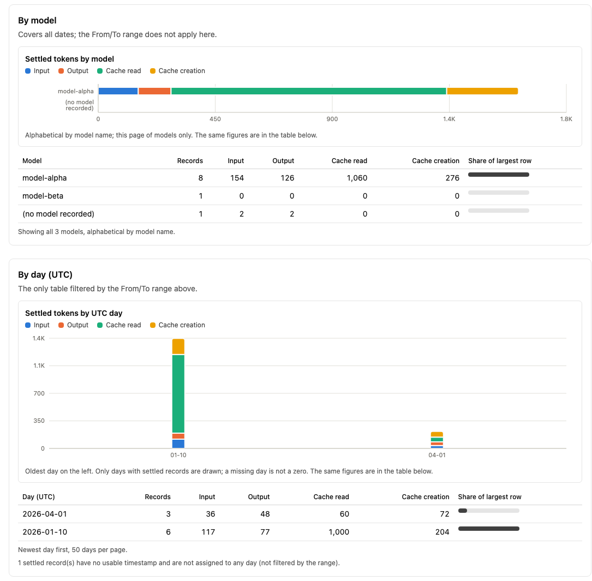
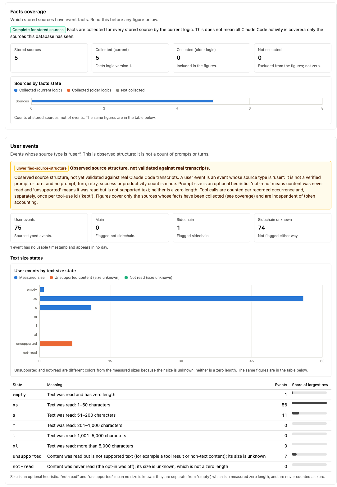
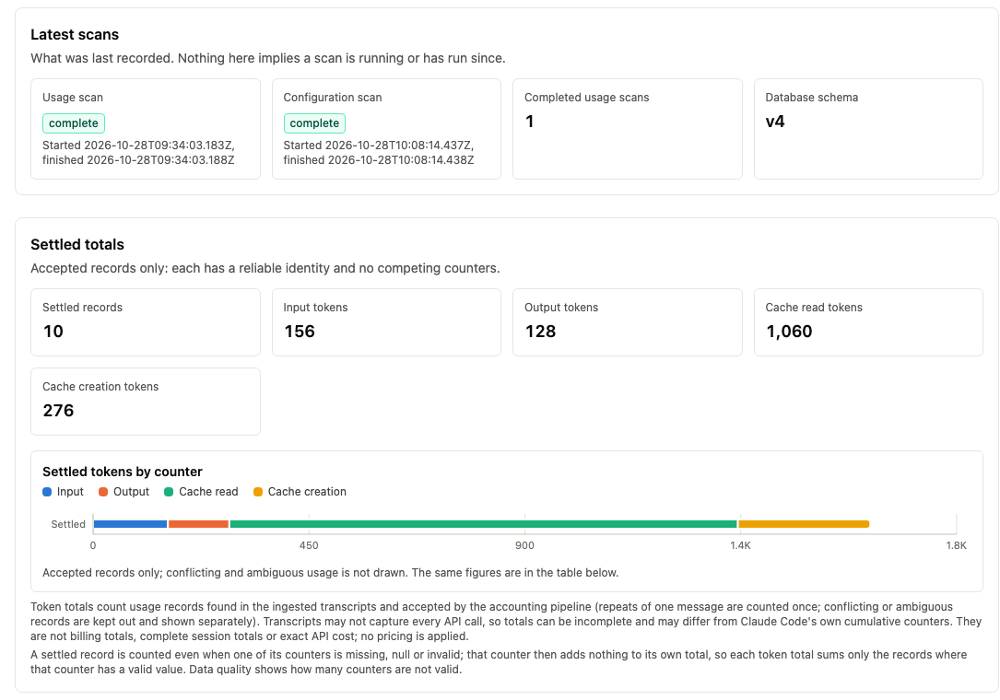

# Claude Code Control Center

A local, **read-only** dashboard for your Claude Code usage and configuration. It shows where tokens go (by day
and by model), flags oversized or broken configuration files (`CLAUDE.md`, rules, agents), and reports how
trustworthy its own numbers are. It runs on `127.0.0.1` only, sends nothing anywhere, and never stores your
prompts or tool arguments.

> **Status: alpha.** Everything has been tested against synthetic fixtures only. The shape of real Claude Code
> transcripts has **not** been validated, so figures from your own data may be incomplete or wrong until it is.
> Please treat the numbers as a rough guide, not as billing or measurement.

## What it does

- **Token usage** from a transcript you choose: settled totals, token by UTC day and by model, and a clear
  separation of records it could not settle (conflicting or ambiguous) instead of guessing.
- **Configuration audit:** inventory of the Claude config files you point it at, estimated size, and static
  findings such as a broken `@import`, with suggestions for you to review.
- **Data quality:** how many records were accepted, skipped or invalid, so you know how far to trust the totals.
- **Event facts (experimental):** counts of event and tool-call *structure*, always labelled as unverified.
- **Charts** with a matching table for every figure, in light and dark mode.

## What it does not do

- It does not measure productivity, prompts, turns, retries, task success or tool success.
- It does not show cost: no pricing is applied, and totals can be lower than Claude Code's own counters.
- It does not search for your files. You name each transcript and configuration directory yourself.
- It does not change anything: no ingest, scan or migration runs from the dashboard.

## Screenshots

All screenshots show **synthetic demo data**, not real usage.

**Usage:** settled tokens by model and by UTC day, with the matching table under each chart.



**Event facts (experimental):** coverage comes first, then the unverified-structure warning and the text size
states; `not-read` and `unsupported` are never shown as a zero length.



**Overview:** latest scans and the settled totals.



## Requirements

- **macOS** (the default data location is under Application Support; other systems are not supported yet).
- **Node.js 24 or newer** (it uses the built-in `node:sqlite`) and **pnpm**.

## Quick start

```
pnpm install
pnpm build
pnpm ingest preview /absolute/path/to/session.jsonl            # prints a confirmation token
pnpm ingest run --db /absolute/path/usage.db --token <token> /absolute/path/to/session.jsonl
CLAUDE_CONTROL_DB_PATH=/absolute/path/usage.db pnpm start      # open http://127.0.0.1:3210
```

Repeat the `run` step for each transcript you want included. Add `pnpm config:scan` for the configuration audit.
New to the pages and numbers? Read [Using the dashboard](#using-the-dashboard-what-to-look-at-and-how-to-read-it)
below; a Vietnamese guide is in [`docs/HUONG_DAN_SU_DUNG.md`](docs/HUONG_DAN_SU_DUNG.md).

## License

[MIT](LICENSE).

The sections below are the detailed reference and development notes.

## Principles
- Runs on `127.0.0.1` only; no LAN/public bind option.
- No telemetry, CDN assets, external APIs or update checks at runtime.
- Never stores prompts, responses, tool arguments or transcript contents.
- App data lives outside the repo (macOS Application Support).
- Tests use synthetic fixtures only (`tests/fixtures/synthetic/`).

## Commands
```
pnpm install
pnpm dev        # http://127.0.0.1:3210
pnpm build && pnpm start   # production build; set CLAUDE_CONTROL_DB_PATH to your database
pnpm lint
pnpm typecheck
pnpm test
pnpm ingest preview <absolute-path>   # see "Ingesting a transcript"
pnpm config:scan --db <abs-db> --user-root <abs-dir> --project-root <abs-dir>   # see "Scanning configuration"
```

The loopback test checks configuration (scripts and constants). It does not prove runtime network isolation.

## Local store

Usage accounting is persisted with the built-in `node:sqlite` (no native dependency) at
`~/Library/Application Support/claude-code-control-center/usage.db` (directory `0700`, file `0600`).
Nothing is created until `openStore` is called. Only structure is stored: salted fingerprints, model
names, timestamps, counters with their raw states (missing / null / invalid / value) and accounting
states. No prompts, responses, tool arguments, file paths or env values.

- **Identity:** events with a message id (else a line uuid) are grouped across all sources; anonymous
  events are keyed by (source fingerprint, line number) and are never merged on payload equality.
- **Rescans:** unchanged sources write nothing; changed sources are replaced inside one transaction and
  affected groups are recomputed. A failed or missing source never deletes its prior records.
- **Totals:** settled = accepted only. Conflicting usage is a lower/upper range; anonymous usage is shown
  as `ifRepeats` / `ifDistinct`. See `src/core/store/ingest.ts` for the full semantics and limits.
- **Limits:** the same bytes copied to another path collapse for identity-bearing events but double the
  anonymous rows; sessions replayed under fresh message ids are not recognized. Fingerprints are salted
  but not anonymization: the salt lives in the same database file.

## Configuration inventory

`scanConfig(roots, { salt })` (in `src/core/config`) is a read-only static audit of explicitly supplied
roots: a `user-config` root (the user's Claude config directory) and/or `project` roots. It never
discovers roots itself. Paths are canonicalized, nothing outside the supplied roots is opened (including
through symlinks or `..`), files above 1 MiB or containing binary data are skipped, and JSON/frontmatter
depth is bounded.

- **Detected is not loaded.** `activation` is one of `unverified-candidate`, `conditional`, `on-demand`,
  `import-only`, `unknown`; there is deliberately no "loaded" value.
- **Findings** carry a stable rule id (`CFG-*`) and rule version, severity, confidence, structural evidence (counts and line
  numbers), limitations and a recommendation. No external model is used and no token saving is claimed;
  token figures are bytes / 4 estimates.
- **Stored (schema v3):** salted fingerprints, sizes, line counts, keyed content hashes, estimated tokens,
  validated frontmatter names/lengths, settings structure as counts, and findings. Never file text, paths,
  hook commands, env values or permission rules. Only a complete scan replaces the current snapshot.
- **Assumed layouts** (rules, agents, skills, settings, CLAUDE.md, `@path` imports) follow documented
  conventions and are validated only against synthetic trees.

Schema history: v1 usage accounting, v2 configuration inventory, v3 adds `config_findings.rule_version`,
v4 adds event facts (`source_files.facts_version`, `source_user_events`, `tool_calls`); all additive and transactional. Files that are not valid UTF-8 are skipped with the code `INVALID_ENCODING`.

## Ingesting a transcript

Usage data enters the database only through one explicit, two-step command. It handles exactly one `.jsonl`
file per run and never discovers anything.

```
pnpm ingest preview /absolute/path/to/session.jsonl
pnpm ingest run --db /absolute/path/to/pilot/usage.db --token <token-from-preview> /absolute/path/to/session.jsonl
```

`pnpm ingest` compiles the command with the installed TypeScript compiler into `.cli-build/` (git-ignored; also
`pnpm cli:build`) and runs it with plain Node. No dependency was added. Output is aggregate numbers and fixed
error codes only.

1. **`preview`** looks at metadata only (`lstat`): it never opens the file, creates nothing, and prints the
   path (to your terminal only), size, timestamps, hard-link count, the read scope, the size limit, what would be
   stored, and a **confirmation token**. It rejects: relative paths, `..`, `.`, `//`, a trailing `/`, wildcard
   characters, control characters, anything not ending in `.jsonl`, directories and other non-regular files,
   symlinks, any path with a symlink in it (give the real path; on macOS `/tmp` is really `/private/tmp`),
   files over the limit, extra arguments and unknown options.
2. **`run`** needs `--db` (absolute, no default and no environment fallback), the exact `--token`, and the path.
   It revalidates everything, recomputes the token, opens the file with `O_NOFOLLOW` and checks the *opened
   handle* against the previewed metadata, and only then creates or opens the database. It reads the file with
   the existing reader, which is capped at the previewed size (so it stops at once if the file grows while it is
   being read), checks again that the handle and the name still match (identity, size, timestamps) and that
   the bytes read equal the previewed size, and only then runs the existing ingest (one transaction). The
   parser and accounting are the existing ones, unchanged.

**Event facts and the optional size opt-in.** Run `pnpm ingest help` for the full text. A source ingested
before event facts existed has none collected; repeat the same `run` command for that one file to collect them.
Usage records, sessions and token totals are left exactly as they are (only that file's facts are written, in the
same single transaction, and a failure rolls everything back). Only files you name are touched; nothing is
discovered or deleted. `--prompt-size` (off by default) additionally reads user-event text in memory only to record
a coarse size bucket; without it the state is `not-read`. Text, excerpts, hashes and exact lengths are never
stored, printed or logged. A source that already has buckets keeps them if you later run without the flag.

**Failures.** Input rejected before any work (exit code 2): nothing was read and nothing was created. A failure
after the database was opened (exit code 3: file changed during the read, database unusable, ingest rolled
back) writes no usage records; the database file may exist and is never deleted or truncated. Every failure is a
fixed code and hint (`REJECTED [TOKEN_MISMATCH] ...`) that never contains a path, input, file content or library
message. Exit codes are always 0 (success), 2 (rejected) or 3 (failed). Once the ingest is committed it is
reported as a success: if standard output is closed or fails at that point (for example `... | head`), the exit
code is still 0 and standard error says `INGEST COMMITTED` (the records were written; only the summary could not
be shown); there is no stack trace. A preview whose output cannot be written is `OUTPUT_FAILED` (exit 3,
nothing created). An unexpected error during `run` says it is not known whether the database changed; it never
claims that nothing was written.

**Token.** SHA-256 over the exact path and the file's device, inode, size, modification time and status-change
time (nanoseconds). It is a consistency check between preview and run, not authentication: anyone who can read
the preview can compute it. It cannot see a change that leaves all of those values identical, and it does not
cover content (the preview never reads content). Restoring the modification time after an edit does not hide the
change, because the status-change time cannot be restored. It is not tied to a database, so it can be reused
for the same unchanged file.

**Size limit: 64 MiB per file, fixed.** The reader keeps every usage record in memory, so cost follows record
count. Measured on synthetic worst-case files (tiny valid lines): 4 MiB 1.3 s / 205 MB, 16 MiB 5.2 s / 632 MB,
64 MiB 26.8 s / 652 MB, 128 MiB 45.5 s / 723 MB peak. 64 MiB is about 20x the only real session observed
(3.0 MiB). The limit is checked before reading, again on the opened handle, and **while streaming**: the reader
is capped at the previewed size (which already passed the limit), so a file that grows during the read is
abandoned after about one chunk instead of being read to its end. There is no override flag; a
different limit is a code change that needs new evidence. Real file sizes are otherwise unknown, so this is a
conservative assumption. The existing 4 MiB per-line cap still applies.

**Database.** Explicit and absolute. An existing database is kept and added to (an older schema is migrated by
opening it, even if the run is later aborted); it is never overwritten, truncated or deleted, and **its
permissions are never changed** (the one exception: an existing empty file that is being initialized as a
database is set to `0600`, because it will now hold data). A new one is created only after every check passed,
with the existing modes (directory `0700`, file `0600`, also under a restrictive umask). Symlinked database
paths or locations are rejected, and so is a database path that is another name (a hard link) for the
transcript: device and inode are compared before anything is touched.

**Stored:** a salted fingerprint of the path (the path itself is not stored), a content hash and size, and per
usage record the model name only if it is a plain identifier, timestamp and UTC day, sidechain flag, the four
counters with their raw state, and the accounting state, plus per-scan counts. **Not stored:** prompts,
responses, tool arguments, file contents, paths, environment values, secrets.

**Known limits.** Change detection is metadata-based. The existing reader opens the file by path, so a change
between the handle check and the read is detected after the read, not prevented, and a swap that restores
identical metadata is not detectable. A detected change aborts before any record is written. Case-only path
differences on a case-insensitive filesystem are treated as a different path. Only one file per run; there is no
directory, glob or discovery mode, no ingest from the dashboard (configuration has its own command, below).

**Inspecting the result:** `CLAUDE_CONTROL_DB_PATH=/absolute/path/to/pilot/usage.db pnpm start`, then open
`http://127.0.0.1:3210`. Token totals are the usage records found in the ingested transcript and accepted by the
accounting pipeline; they may be incomplete (see "What the token totals mean" below).

## Scanning configuration

```
pnpm config:scan --db /absolute/path/to/usage.db --user-root /absolute/path/to/claude-config-dir --project-root /absolute/path/to/project
```

(`pnpm config` is a built-in pnpm command, so the script is `config:scan`.) It runs the existing static scanner
(`scanConfig`) on exactly the roots you name and saves the result with the existing persistence
(`saveConfigInventory`); there is no second implementation. It never searches for roots.

- **Explicit inputs:** `--db` and at least one of `--user-root` (your Claude config directory itself) or
  `--project-root` (a project directory), each at most once. There is no default database, no environment fallback
  and no discovery. Roots say what they are, so the scanner never guesses a layout.
- **Scan everything in one command.** A complete scan replaces the database's current configuration snapshot, so
  scanning the user root and a project root in two separate runs leaves only the second one current.
- **Rejected before anything is created (exit 2):** relative, empty, over-long, wildcard, control-character or
  non-normal paths (`..`, `.`, `//`, trailing `/`); a root that does not exist, is not a directory, is a symbolic
  link or has a symbolic link in its path (stricter than the library, so the directory scanned is the one named);
  both roots being the same directory; a database path that is invalid, a symlink, not a regular file, inside a
  scanned root, or an existing file with more than one name (it could be a hard link to a scanned file).
- **Database:** a new database is created 0600 in a 0700 directory, as for ingest; an existing file keeps its
  mode (except an empty file, which becomes 0600). An older schema is migrated when opened. The roots are checked
  again after the database is opened, immediately before the scan.
- **What is read:** only the files the scanner recognises under the roots (CLAUDE.md, settings JSON, rules,
  agents and skills), with the scanner's limits unchanged: no link followed out of a root, files over 1 MiB or
  binary skipped, nothing executed, nothing enabled, no network, no model call. No labels are stored.
- **Output:** aggregates only (counts by scope and category, skipped files by fixed code, import statuses, finding
  counts by severity). No path, file name, setting value or file content is printed.
- **Exit codes:** 0 complete scan saved (if standard output was closed, a `CONFIG SCAN RECORDED` notice goes to
  standard error and the exit is still 0); 2 rejected before any work; 3 failed after work began, which includes
  a **partial or failed scan** (a root became unavailable): it is recorded as history only, the current snapshot is
  **not** replaced, and the message says so (`SCAN_INCOMPLETE`). Files the scanner skips (too large, binary,
  unreadable) are normal in a complete scan and are counted by code.
- **Limits:** the scan reads the roots as they are while it runs; a file changed during the scan is read as it is
  at that moment. Detected is not loaded: nothing here shows that a file is active.

## Using the dashboard: what to look at and how to read it

A practical guide to the pages, the figures on them and what each figure does and does not mean. (A Vietnamese
version of the workflow is in `docs/HUONG_DAN_SU_DUNG.md`.) The dashboard only reads a database you filled
yourself; the repository's tests and any demo data are synthetic, so their numbers mean nothing.

### Step by step

```
pnpm install
pnpm build
pnpm ingest preview /absolute/path/to/session.jsonl                      # prints a token
pnpm ingest run --db /absolute/path/usage.db --token <token> /absolute/path/to/session.jsonl
pnpm config:scan --db /absolute/path/usage.db --user-root <dir> --project-root <dir>   # optional
CLAUDE_CONTROL_DB_PATH=/absolute/path/usage.db pnpm start               # http://127.0.0.1:3210
```

Repeat `ingest run` for each file you want included (one file per run). Use a database path that is not inside
a directory you scan. Nothing is discovered automatically.

### Which pages are worth your time

| Priority | Page | Use it to | Trust level |
|---|---|---|---|
| 1 | **Data quality** (`/quality`) | check that the data is clean, once after each ingest | high (counts of what was parsed) |
| 2 | **Overview** (`/`) | see the settled totals and how much is unresolved | high for settled, partial for the rest |
| 3 | **Usage** (`/usage`) | see token use by day and by model | good for relative comparison |
| 4 | **Configuration audit** (`/config`) and **Recommendations** | find oversized or broken configuration files | static analysis only |
| 5 | **Event facts** (`/analytics`) | see the structure of events and tool calls | low: unverified structure |
| - | **Run history**, **Source coverage** | confirm an ingest worked and which files the database has seen | bookkeeping, not usage |

Suggested first pass on real data: Data quality, then Overview, then Usage, then Configuration audit.

### Reading the token figures (Overview, Usage)

- **Settled records / tokens** count only *accepted* usage records: records with a reliable identity and no
  competing counters. This is the one figure that is settled.
- **Input** is new, uncached input. **Output** is what the model wrote. **Cache read** is context re-read from
  the cache; it is usually the largest number and that is normal, not waste. **Cache creation** is context
  written to the cache the first time.
- Use the figures to compare days or models with each other. They are not billing totals, not exact API cost
  (no pricing is applied) and can be lower than Claude Code's own cumulative counters, because transcripts may
  not record every API call.
- **Unresolved (Overview):** *Conflicting groups* are records with the same identity but different counters;
  *Ambiguous records* have no reliable identity; *Duplicates excluded* are identical repeats of an accepted
  record. None of these is added to the settled totals; conflicting and ambiguous usage is shown as a range or
  under both interpretations. If these are large compared with the settled records, treat the totals as
  incomplete.
- **Usage page:** days are UTC; the From/To filter applies to the day table and chart only; the sidechain toggle
  (sub-agent events) applies to all three tables. A day with no settled records is not drawn and is not a zero.
  The session table is a page ordered by opaque id, not a top-N.

### Reading Data quality

- **Accounting states:** every stored record is `accepted`, `duplicate`, `conflicting` or `ambiguous`. A low share
  of `accepted` means the Usage totals deserve less trust.
- **Counter states:** per token counter, how many records have a valid `value` versus `missing`, `null` or
  `invalid`. A settled record is still counted when one counter is not valid; that counter then adds nothing to
  its own total.
- **Latest scan diagnostics:** skipped lines (malformed, non-object, blank, oversized), events without usage,
  unusable timestamps and identity-uncertain sources. These describe the latest scan only.

### Reading Configuration audit and Recommendations

- **Inventory** counts files by scope (user/project) and category (CLAUDE.md, rule, agent, skill, settings),
  with estimated tokens (bytes / 4, a rough size and not tokenizer output). Large files can enlarge the context
  of every session. Present on disk does not mean loaded: activation is always unverified.
- **Findings** are static checks (for example a broken `@import`), with severity, confidence, limits and a
  suggested action. **Recommendations** are suggestions for a person to review; nothing is applied and no saving
  is claimed. *Rules evaluated* shows which rules fired, did not trigger, or lacked evidence.

### Reading Event facts (unverified)

Every figure on this page describes **observed source structure that has not been validated against real
transcripts**. The page and the API say so (`validation: "unverified-source-structure"`).

- **Facts coverage (read first):** how many stored sources have facts. *Facts not collected* means no figures are
  shown (never zeros); *Partial coverage* means every figure covers only the collected sources; *Complete* means
  every stored source, not all Claude Code activity. Facts are collected by running `ingest run` again for a file.
- **User events:** events whose source type is `user`. This is not a count of prompts or turns, and no retry,
  success or productivity figure exists. Split into main, sidechain and sidechain-unknown.
- **Text size states:** `empty`/`xs`/`s`/`m`/`l`/`xl` are measured only when you ingested with `--prompt-size`
  (1-50, 51-200, 201-1000, 1001-5000, over 5000 characters). `unsupported` means the content was read but is not
  supported text; `not-read` means it was never read (the default). Neither of those two is a zero length.
- **Tool calls:** `tool_use` blocks by bucket (a fixed list of built-in names; every other name, including
  `mcp__*`, is `other`; a missing name is `unknown`). *Occurrences* counts every block; *Kept* is one per
  tool-use id plus every call with no id; *Duplicates* are repeats of an id; *Anonymous* calls have no id and are
  never merged. They count parsed structure and do not show that a tool ran or succeeded; duplicates are not an
  error measure.
- **Daily facts** (UTC, with an *undated* slice for facts without a usable timestamp) and **Sessions** (short
  opaque references, 50 per page; the reference is not a Claude session id and identifies no user, device or
  project).

### Charts

Charts use Recharts and always sit above the table with the same figures (the table is the accessible
equivalent). Hover or focus a bar for a tooltip. Colors follow the entity: each token counter keeps one color on
every chart; `not-read` and `unsupported` have their own colors so they cannot be mistaken for a zero length;
buckets with no occurrences are left out of the tool chart (the table lists them all); a missing day is never
drawn as zero. Light and dark follow the operating system.

### Messages you may see

| Message | Meaning | What to do |
|---|---|---|
| No database yet | The file does not exist; nothing was created | Run `ingest run` or set `CLAUDE_CONTROL_DB_PATH` |
| No completed usage scan | The database has no completed scan | Ingest a file |
| `SCHEMA_OUTDATED` | The database is older than this version | Run `ingest run --db <db> ...` once; the dashboard never migrates |
| Facts not collected | Sources exist without event facts | Run `ingest run` again for each file |
| `QUERY_FAILED` | A query failed | Only a fixed code is shown, never details |

## Read-only API and dashboard

`pnpm dev` / `pnpm start` serve the dashboard on `127.0.0.1:3210`. Pages: Overview (`/`), Usage
(`/usage`), Configuration audit (`/config`), Event facts (`/analytics`), Data quality (`/quality`), Run history (`/history`) and Source coverage (`/sources`). They are server-rendered
from the same operations as the API; nothing runs in the browser.

- **Database location:** `CLAUDE_CONTROL_DB_PATH` (absolute) or the default location above (`~/Library/Application Support/claude-code-control-center/usage.db`). It is opened with
  `readOnly`; the dashboard never creates, migrates or writes it. A missing file shows an empty state
  and creates nothing. Create and fill it explicitly: usage with `pnpm ingest` (see "Ingesting a transcript"),
  configuration with `pnpm config:scan` (see "Scanning configuration"). A database that needs migrating is reported as `SCHEMA_OUTDATED`.
- **States:** every response is `{ state, data, errorCode }` with `state` one of `ok`, `no-database`,
  `no-completed-scan`, `unavailable`. Failures carry a fixed code only, never a message, path or SQL.
- **Endpoints (GET only, no body, no SQL, no paths):** `/api/status`, `/api/usage/summary`,
  `/api/usage/models`, `/api/usage/days`, `/api/usage/sessions`, `/api/usage/quality`,
  `/api/config/summary`, `/api/config/findings`, `/api/recommendations`, `/api/runs`, `/api/runs/detail`, `/api/sources`, `/api/sources/detail`. Query parameters are strict: `sidechain`
  (`include` default | `exclude`), `limit` (1-200, default 50), `offset` (0-100000), `from`/`to` (UTC
  `YYYY-MM-DD`, at most 366 days), `severity`, `ruleId`. Invalid input is a 400 naming the parameter.
- **Run history (`/history`, `/api/runs`, `/api/runs/detail?id=`):** lists the usage scans already stored in
  `scan_runs`, newest first (start time, then run id, so the order is total), with `limit`/`offset` paging (1-200).
  Each run shows its kind (`complete`, `partial`, `failed` = every source failed, `rolled-back`, `unfinished`),
  timestamps, sources requested, source outcome counts and records inserted/removed. Counters are stored only when a
  scan finishes and commits, so a rolled-back or unfinished run shows them as `null` / "not recorded", never as 0;
  a stored 0 is shown as 0. The detail adds per-source outcomes, fixed error codes and skipped-line diagnostics,
  with sources numbered by position. Paths, labels, fingerprints, content and database error text are never
  exposed (codes and times that are not in the expected fixed form are replaced). Only usage scans are listed;
  configuration scan history is not shown. Nothing here writes, migrates or creates the database.
- **Source coverage (`/sources`, `/api/sources`, `/api/sources/detail?ref=`):** lists the sources the database has
  observed and each one's recorded history, with `limit`/`offset` paging. A source is addressed by `ref`, an opaque
  32-hex digest of its stored fingerprint: stable within one database, not a path, name, label, salt or internal id.
  The list is ordered by the source's most recent recorded result (run start, then run id, then storage order).
  - *What is shown:* first-seen and last-read run, number of recorded results, counts by outcome, the latest outcome,
    records currently stored for the source, and per-run inserted/removed/retained counts and skipped-line
    diagnostics in the detail. A failed read has no line or record figures: they are `null` / "not recorded", not 0.
  - *What it does not claim:* a source with no result in the newest committed run is shown as "no result", never as
    deleted: a scan covers only the files it was asked to read, and nothing here checks the disk. A partial or failed
    run is not complete coverage, and the sources listed are not all Claude Code activity. `lastRead` moves only on a
    successful read.
  - *Known gap:* a failed read of a file that was not yet stored cannot be attributed to a source (the link is made by
    fingerprint at write time), so a source's history is a lower bound of what was attempted. `historyIncomplete` is
    set only when the first-seen or last-read run has no recorded result for the source. A rolled-back scan stores no
    source results and so never appears here (see Run history).
  - Fixed codes only; a status, outcome, code or time that is not in the expected form fails closed. Read-only: no
    ingest, no migration, no database is created.
- **Event facts (`/analytics`, `/api/analytics/summary`, `/trends`, `/tools`, `/sessions`, `/sessions/detail?id=`):**
  GET-only, read-only counts over the persisted event facts, shown with the same envelope states as the other
  endpoints plus a coverage block. Every payload is labelled `unverified-source-structure`: it is observed
  structure that has not been validated against real transcripts.
  - *What is counted:* events whose source type is `user` (not prompts or turns; no prompt, turn, retry, success or
    productivity figure exists), and `tool_use` blocks by bucket (a fixed built-in name list; every other name is
    `other`, a missing one `unknown`), as occurrences, kept calls (one per tool-use id, plus every call without an
    id) and duplicates. Counts describe parsed structure, not that a tool ran or succeeded.
  - *Size states:* `empty`/`xs`/`s`/`m`/`l`/`xl` are measured only when the ingest was run with `--prompt-size`;
    `unsupported` means the content was read but is not supported text; `not-read` means it was never read. Neither
    of the last two is a zero length.
  - *Coverage:* figures cover only sources whose facts were collected. A database with sources but no facts shows
    that state instead of zeros; partial coverage is labelled. Complete coverage means every stored source, not all
    Claude Code activity. Facts are collected only by an explicit ingest of a named file (see "Ingesting a
    transcript"); there is no directory-wide or automatic backfill.
  - *Not included:* token figures. Facts are independent of the settled usage totals and never change them.
  - Session references are the same short opaque prefixes as the usage sessions; parameters are `from`, `to`,
    `limit`, `offset`, and `id` (16 hex) for the detail, validated like the other endpoints.
- **Ordering and paging:** days are listed newest first, models alphabetically and sessions by opaque id
  (a page, not a top-N; the page says so). Page sizes are shown next to each table.
- **Semantics:** totals reuse the store aggregates unchanged. Settled = accepted records only;
  conflicting groups are ranges and ambiguous records are shown under both interpretations, never added
  to settled totals. `stateCounts` cover all stored records regardless of `sidechain`. Configuration token
  figures are bytes / 4 estimates. Inventoried files are present on disk, never shown to be loaded.
- **What the token totals mean:** Overview and Usage show the same note next to every token total. Token
  totals count usage records found in the ingested transcripts and accepted by the accounting pipeline
  (repeats of one message are counted once; conflicting or ambiguous records are kept out and shown
  separately). Transcripts may not capture every API call, so totals can be incomplete and may differ from
  Claude Code's own cumulative counters. They are not billing totals, complete session totals or exact API
  cost; no pricing is applied. A one-file pilot found the settled totals were exact for what the transcript
  recorded but lower than a cumulative counter inside the same file; what that counter covers has not been
  established, so no percentage of "missing" usage is claimed anywhere.
- **Counters that are not valid:** A settled record is counted even when one of its counters is missing, null or invalid; that counter then adds nothing to its own total, so each token total sums only the records where that counter has a valid value. Data quality shows how many counters are not valid. In a conflicting range a missing, null or invalid counter counts as 0 in the bounds. Nothing here claims a total is a bound on all usage.
- **Partial or failed scans:** when no scan has completed but the latest usage scan is partial or failed, the pages say that records from sources that were read successfully may already be stored while no usage figures are shown until a scan completes. No record count is given: the only count available (records inserted by the latest scan) is not the number stored.
- **Usage filters:** The From/To range filters the day table only. The model and session tables cover all dates; the sidechain toggle applies to all three. The `(unrecognized model name)` row is explained on the page: its identifiers did not match the recognized-name policy, and legitimate identifiers can be grouped there. The original values are never shown.
- **Data quality diagnostics:** These diagnostics describe the latest scan only, so skipped-line and parsing issues from earlier scans of sources the latest scan did not include may not appear, although those sources' records stay stored. Skipped categories shown: Malformed lines, Non-object lines, Blank lines (empty or whitespace-only), Oversized lines and Malformed usage objects. "Unrecognized usage key occurrences" counts occurrences across usage objects, not distinct key names.
- **Privacy:** responses hold counts, fixed codes, opaque ids (session ids are short salted prefixes) and
  rule metadata. Finding evidence is re-validated on read and withheld if unsafe; an unknown accounting
  state fails closed instead of being echoed.

### Host validation

`src/proxy.ts` (Next.js 16's renamed middleware) runs before every request, including pages, API routes and
static assets, and answers `403 Forbidden` (empty of detail) unless the `Host` header is exactly
`127.0.0.1:3210` or `localhost:3210` (hostname case-insensitive). Forwarding headers are never consulted.
`CLAUDE_CONTROL_PORT` changes only the accepted port (used by tests that start the server on a free port);
the start scripts still pin `-p 3210`. IPv6 (`[::1]`) is not accepted because the server does not bind to it.

This blocks DNS-rebinding pages from reading the dashboard through a hostname they control. It is one layer,
not a complete defense: it does not stop other local processes from connecting to the port, and it does not
replace binding to loopback. Known platform limits, covered by `tests/next.runtime.test.ts`:

- Node's HTTP parser keeps only the first of duplicate `Host` headers, so the application cannot see a
  duplicate; the request is judged on the first value. Browsers never send two.
- HTTP/1.1 requests without `Host` are refused by Node itself (400); HTTP/1.0 without `Host` reaches the
  proxy and gets 403.
- Next.js redirects an absolute-form request target (`GET http://host/path`) before the proxy runs. The
  response has no body and no data; browsers do not send that form to origin servers.

### Test isolation

`tests/setup.ts` runs before every test file. It points `CLAUDE_CONTROL_DB_PATH` at a nonexistent temp
path and makes `defaultDatabasePath(<real home>)` throw, so a test that forgets to choose a database fails
loudly instead of reading the production location. Tests that need data build a temporary synthetic
database. `tests/next.runtime.test.ts` runs `next build` and starts `next start` on a free loopback port
against such a database; it needs a few seconds and a writable `.next` (do not run it while `pnpm dev` is
using the same directory).

## Recommendations

`/recommendations` and `GET /api/recommendations?category=&priority=&limit=&offset=` list deterministic,
explainable suggestions for **human review**. They are derived at read time from the current audit findings
and usage aggregates by a pure engine (`src/core/recommend`); nothing is stored (no migration), applied or
executed, no model is called, and there are no apply/fix controls. Each finding now exposes its stable `id`,
which recommendations cite as evidence.

| Rule (version) | Needs | Category | Priority |
|---|---|---|---|
| `REC-CFG-DUP` (1) | a `CFG-DUP-001` finding covering 2+ items (near-duplicates alone are not enough) | configuration hygiene | low |
| `REC-CFG-CONFLICT` (2) (`:instructions`, `:permissions`) | `CFG-CONF-001` / `CFG-CONF-002` findings; the permission count is the scan-wide number of distinct rules (exact from audit rule v2 evidence, otherwise "at least") | configuration hygiene | medium |
| `REC-CTX-SIZE` (1) | `CFG-SIZE-001/002` findings (one count per item) | context efficiency | low (medium if very large) |
| `REC-CFG-ACTIVATION` (2) | an inventory with at least one item; covers every inventoried item, cites `CFG-ACT-001` findings when present | configuration hygiene | info |
| `REC-DQ-ACCOUNTING` (3) | conflicting groups, ambiguous records or identity-uncertain sources | data quality | medium if conflicting, else low |
| `REC-USE-MODELS` (3) | see below | usage insight | info |

Versions change only when a rule's semantics or emitted evidence change (`REC-DQ-ACCOUNTING` and
`REC-USE-MODELS` moved to 3 for the identity-uncertainty rule, sidechain-by-state reporting and the model
policy). Nothing is stored for recommendations, so no data needs migrating.

**Model observation thresholds (all in records, inclusive):** at least 30 settled records; at least 90% of
settled records carry a *recognized* model identifier; at least 2 distinct recognized models; and unresolved
records (records inside conflicting groups, plus ambiguous records) at most 10% of settled plus unresolved
records. The number of records in conflicting groups comes from the stored accounting states, never from the
group count; if group and record counts contradict each other the rule reports insufficient evidence.

**Model identifier policy** (`src/core/recommend/model-name.ts`, used by the recommendation *and*
`/api/usage/models`). ASCII, at most 64 characters, case-insensitive, shown lower-case:
`[provider/]base[@version][[context]]`.
- `provider/` is optional, allowed once, and only for a short allowlist (`anthropic`, `openai`, `google`,
  `meta-llama`, `mistralai`, `deepseek`, `x-ai`, `amazon`, `cohere`, `qwen`, `bedrock`, `vertex_ai`, `azure`,
  `openrouter`). `base` starts with a letter or digit, then letters, digits and `. _ : -`, never `..`.
- `@version` is 6-10 digits or `latest` (Vertex style). `[context]` is digits plus `k` or `m` (`[1m]`).
- Accepted: `claude-opus-4-1-20250805`, `us.anthropic.claude-sonnet-4-5-20250929-v1:0`,
  `claude-3-5-sonnet-v2@20241022`, `anthropic/claude-sonnet-4.5`, `claude-sonnet-4-5[1m]`.
- Rejected (counted as unrecognized): any other `/` (`home/someone/project`, `a/b`, `anthropic/../x`,
  `/abs`), `\`, `~`, `://`, free-text `@` (`user@example.com`), other brackets (`claude[<b>]`), whitespace,
  control and non-ASCII characters, `<synthetic>`, longer names.
- Limitations: it is a shape check, not proof a model exists; a legitimate provider outside the allowlist is
  rejected until added deliberately. Unrecognized values are never displayed: `/api/usage/models` merges them
  into one `(unrecognized model name)` row and the recommendation reports one unattributed total. Case
  variants are summed into one canonical row in both places; totals never change. Ties and row order use code
  units, never locale (`model-1` before `model_1`). The core `settledByModel` still groups raw names; the
  canonicalization is applied on top of it.

**Scope and sidechain:** recommendations cover all events, sidechain (sub-agent) events included, and the
Usage page's sidechain filter does not apply. Sidechain records are reported *by accounting state* from the
stored per-record flag: `settledSidechainRecords`, `conflictingSidechainRecords`, `ambiguousSidechainRecords`
(and `unresolvedSidechainRecords` = the last two, in the model observation). A settled-only count is never
presented as the total; records whose sidechain flag is unknown are not counted as sidechain.

**Identity uncertainty:** a source is uncertain when a successful `modified` read (completed or partial scan)
flagged it **and** anonymous records are still stored for it. Unchanged reads, appends, failed source reads
and failed scans never create or clear it, and a clear flag alone proves nothing; it clears only when the
source stores no anonymous record. Limitation: the schema keeps no per-read anonymous count, so a source that
was resolved and later gains new anonymous records through an append is reported uncertain again (it errs on
the side of keeping the warning). Recording the anonymous count in the existing `detail_json` of each source
result would remove that, without a migration. The Data quality page and the recommendation use this same
figure; the per-run figure is shown separately.

**Permission identity:** a permission rule is identified by its exact string (the audit stores only a hash of
it, never the text), so entries differing in whitespace or case are different rules. Normalizing could merge
rules Claude Code treats differently, and the stored evidence cannot support it. `CFG-CONF-002` v2 findings
carry the scan-wide distinct count; findings stored before that (v1) lack it and are reported as "at least N".

- **Priority** is the order of human review, not harm or saving. **Confidence** is confidence in the
  observation (the weakest of the findings it rests on, or the rule's stated rationale), never in the
  benefit of acting. **Impact** is qualitative: `unknown` (nothing measurable) or `limited` (affects how far
  totals can be trusted). There are no numeric savings or scores.
- A rule without its evidence produces nothing (no generic advice); the page lists every rule with its
  outcome (`generated`, `not-triggered`, `insufficient-evidence`) and a fixed reason. Findings from an
  audit rule version a recommendation does not understand are ignored and reported as such.
- The page opens with a short legend (priority is review order; confidence is in the observation; impact is
  qualitative). Facts (what the data shows) and inferences (what is suggested but not established) are kept apart.
  Model names are shown only if they look like plain identifiers. Descriptive model observations never
  suggest changing models.
